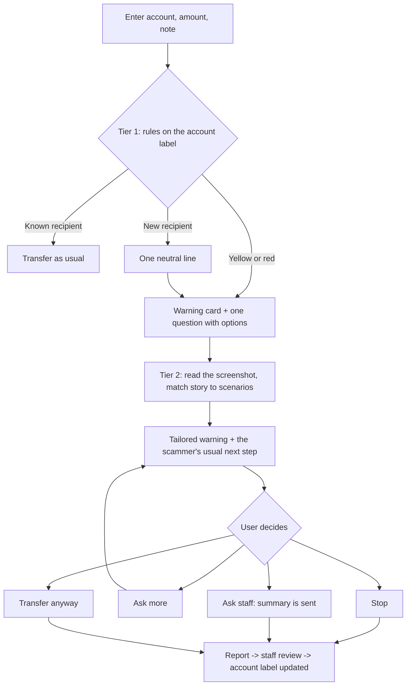

# Pretransfer Scam Assistant

An assistant that steps in at the moment a wallet user is about to send money to a risky account. It asks what the transfer is for, reads a screenshot of the conversation that led to it, tells the user which known scam the situation resembles, and turns the exchange into a structured report for fraud staff.

Entry for MoMo Tech Contest 2026, topics "Anti-fraud" and "AI assistant".

## The problem

More than 90% of online-scam victims make the transfer themselves, under pressure from a story told on Zalo, Messenger, SMS or a phone call. A wallet app only sees the last step. It can flag a risky receiving account, but it does not know the story, so its warning is generic.

## What the product does

Two tiers:

- **Tier 1, the label at the confirm screen:** normal / yellow / red, from the receiving account's risk label plus a few rules. We treat this as an existing input (sample data in the demo). It is not what we measure.
- **Tier 2, right after the label appears (our work):**
  1. One question with tap-to-answer options: "What is this transfer for?" The user may attach a screenshot of the chat and may keep chatting.
  2. The assistant matches the story and the screenshot against a library of 15 scenarios (11 scams, 4 ordinary transfers), says which scam it resembles and why, what the scammer usually does next, and one thing to check.
  3. The user decides: stop, ask more, ask a staff member, or transfer anyway. The assistant never blocks.
  4. Every outcome becomes a structured report. When staff confirm it, the account's label changes and the next sender is warned earlier.



## Models

Closed models (Gemini, GPT, Claude) and open models on a 16 GB GPU were measured side by side for each job. Which of them the live build uses is not decided yet; the numbers are below and in [`EXPERIMENTS.md`](EXPERIMENTS.md).

| Id | Model | Job | Trained on | Scored on | Experiment | State |
|---|---|---|---|---|---|---|
| M1 | Vision model that reads a screenshot | Chat screenshot to JSON: messages, who said what, account numbers, phone numbers, links, amounts | Open models: LoRA on screenshots rendered from HTML (exact labels). Closed models: not trained | Real scam screenshots published by police and news sites | E4, E10 | Measured. No open model reached the closed ones; LoRA training of readers was stopped |
| M2 | LLM for the conversation | Ask follow-ups, pick the scenario, write the warning | Not trained | 300 simulated sessions; 300 more with a screenshot | E5, E10 | Measured. One open model (`gemma-4-e4b-qat`) is within 5 points of the closed reference |
| M3 | Small text classifier on CPU | Second opinion on the scenario, with probabilities | Simulated user stories, labels set by us | Held-out simulated sessions + stories from real reported cases | E6 | Measured, kept. Not wired into the app yet |
| M4 | Label propagation on the account graph | A confirmed report spreads to linked accounts | Sample data | No meaningful accuracy number; shows the mechanism only | - | Postponed |

Keep-or-drop conditions for M1-M3 were written down before any numbers came in: [`docs/specs/2026-11-22-ke-hoach-model-va-thi-nghiem.md`](docs/specs/2026-11-22-ke-hoach-model-va-thi-nghiem.md), section 5.

## Results so far

All on small sets; they guide choices and are not quality claims. Details in [`EXPERIMENTS.md`](EXPERIMENTS.md).

- **Reading real screenshots (E4, E10; 56 images, 117 strings):** `gemini-3.5-flash-lite` found 92.3% of the strings in 2.6 s per image, but 26.2% of the strings it returned were not in the image. Claude Haiku 5.5 found 88.0% with 9.3% made up, in 7.3 s. The best open model (`qwen3-vl-4b`) found 76.1% in 12 s; LoRA moved it within noise.
- **Conversation, text only (E2, E5, E10; 300 simulated sessions, at most 3 questions):** the LLM asks its own questions (code-picked questions scored 69.3% vs 78.7% on 75 sessions and were dropped). Correct scenario: Claude Haiku 5.5 81.7%, `gemini-3.5-flash-lite` 81.3%, open `gemma-4-e4b-qat` 77.0%, open Qwen3 8B and 14B 70-75%.
- **Conversation with a screenshot (E10; 300 simulated sessions):** reading the image to JSON first and chatting on the JSON scored 93.3%; letting the chat model look at the image itself scored 86.7% and flagged twice as many ordinary transfers (14 vs 6 of 80). The app keeps the two-step flow.
- **Second opinion (E6, E10):** the CPU classifier catches 53-88% of the LLM's wrong conclusions, depending on the chat model, and flags 4-8% of the correct ones.
- **Not measured yet:** anything with real users. Sessions with a screenshot use synthetic images only.

## Catalogue v2

Since 26/11 the scenario library has 25 scenarios: 15 scam and 10 ordinary, six of them look-alikes of a scam (paying the courier on delivery, a bill from a school or hospital, moving money to one's own account, a loan repayment, a wedding gift or shared fund, a checked booking). The case generator now draws the account label by group and never gives an ordinary story a scam-type detail. The results above were measured on the 15 scenarios of catalogue v1 and stay as that record; the 300 simulated cases are unchanged. First numbers on v2 (T4, details in [`EXPERIMENTS.md`](EXPERIMENTS.md)): the CPU classifier retrained on 25 scenarios is right on 73-78% of held-out stories and 2.8-4.2 points worse on the old 15; it calls 10 of 84 real scam stories ordinary, 7 of them through a new look-alike; the scenario list in the chat prompt grows by about 1,400 tokens per call.

## What exists today

| Part | State |
|---|---|
| Scenario library, `scenarios/*.yaml` | 25 scenarios (catalogue v2) with sources, signs, what to check, the scammer's next steps |
| Core, `core/` | Session, scenario matching, image reading, account lookup on sample data. Calls Gemini today |
| Sample app, `app/` + `web/` | FastAPI + SQLite: transfer page with a chat panel, staff page that reviews reports and changes account labels. Plain HTML, local only |
| Simulator, `sim/` | An LLM plays the user from a fixed story; code scores the assistant. 300 cases in `sim/cases/` |
| Image experiments, `e1/` | Chat screenshot generator (HTML + Playwright), OCR/VLM runners, scoring |
| Not built yet | The two-tier UI above (wallet-style confirm screen, one-tap question, tier-specific buttons), open-model serving, deployment |

## Data

| Set | Size | What it is | Where |
|---|---|---|---|
| Scenarios | 15 | Scam and ordinary-transfer scenarios written from public police/news warnings | git, `scenarios/` |
| Simulated cases | 300 (15 x 20) | One simulated user each: true scenario, story table, persona, opening message | git, `sim/cases/` |
| `E1` screenshots | 180 | 30 HTML-rendered chats (Zalo, Messenger, SMS look) x 6 variants, exact labels | Drive, `data/E1/` |
| `E1b` hard screenshots | 100 | Downscaled, double-JPEG, re-photographed, long chats | Drive, `data/E1b/` |
| `gen` screenshots | 40 | Made by an image model, labels reviewed by eye | Drive, `data/E1b/gen/` |
| `web` real screenshots | 56 | Real scam chats/SMS published by police and news sites, with source URLs and string labels (all 56 labelled; experiment numbers so far cover the first 20). Evaluation only: never train on them, never republish | Drive, `data/E1b/real/` |
| Real reported cases | 89 | Scam cases from news/police reports: verbatim quote, summary, a first-person retelling from just before the transfer, scenario label | Drive, `data/narr/real/` |
| `E4` training screenshots | 4000 + 300 + 300 | Synthetic chat screenshots for the image-to-JSON model (M1), made by `e1/gen_train.py`: 7 app templates, 13 scenarios, random damage. `val_la` is held out (WhatsApp template, 2 unseen scenarios). Each image has labels and the exact JSON the model must output | Drive, `data/E4/` |
| `E6` stories | 3300 | Simulated user stories with the true scenario, for the small text classifier (M3) | Drive, `data/E6/cases.jsonl` |
| App recording notes | 35 frames | Layout notes of a wallet's transfer flow, used to design the sample UI | Not shared by default; ask Minh |

No real user data. All account numbers, phone numbers and names in generated sets are made up.

## Data and weights (Google Drive)

`data/` and model weights are not in git. They are shared as a plain folder on Google Drive (no archive), so everything can be browsed online.

- **To look first:** open `preview/` in the Drive folder: one contact sheet per image set, plus two full-size samples per set with their label files. The Drive `README.md` lists every set.
- **To use:** download the Drive `data/` folder and put it at the repo root.
- **To share:** `python3 scripts/export_data.py` (needs Pillow and rsync) builds `../drive_upload/pretransfer-data/` with `README.md`, `preview/` and a copy of `data/` (about 1.1 GB today, most of it `data/E4/train`). Upload that folder. Rerun after new data; only changes are copied.
- **Weights:** base models are downloaded from Hugging Face by the scripts. Our own LoRA adapters and classifier weights do not exist yet.

## Repo map

| Path | Content |
|---|---|
| `docs/specs/` | Design and plan (Vietnamese). Start with `2026-11-22-ke-hoach-model-va-thi-nghiem.md` |
| `docs/tasks/` | One brief per task or experiment (Vietnamese) |
| `EXPERIMENTS.md` | Short log of each experiment: question, data, result, decision. Raw outputs and long reports stay on our machines |
| `scenarios/`, `core/`, `app/`, `web/`, `sim/`, `e1/`, `tests/` | See "What exists today" |
| `scripts/` | GPU-server pipelines, `export_data.py` |

## Run

```bash
python3 -m venv .venv && .venv/bin/pip install -r requirements.txt   # once
./run_app.sh                       # sample app at http://localhost:8000/ , staff page at /web/staff.html
.venv/bin/python -m pytest -q      # unit tests, no model calls
.venv/bin/python -m sim.perfect    # scenario-matching ceiling, no API cost
```

`.env` (not in git) holds `GEMINI_API_KEY`, optionally `OPENAI_API_KEY`, `CLAUDE_API_KEY`, and `SERVER=user@host` for the GPU-server scripts. API budgets are capped; see section 7 of the plan before running anything that calls a paid model.

## Open questions for the team

- Does the two-tier split read as new, given that wallets already show receiver labels? Our claim is the step after the label, not the label.
- M4 (graph) is the weakest part. Keep, replace with something else, or cut?
- Which parts each person takes: sample-wallet UI, open-model serving and deployment, data collection and labelling, slides and video.
- Hosting from 3 to 11 Dec: a GPU has to stay online for three weeks. Not decided.
- More real screenshots and real cases are the most valuable data we can add by hand.

## Declarations required by the contest rules

Updated until submission.

| Item | Content |
|---|---|
| Pre-existing assets | None used so far |
| Open-source libraries | App and core: FastAPI, Starlette, Uvicorn, python-multipart, Pydantic, PyYAML, google-genai; tests: pytest, httpx. Image experiments: PaddleOCR, Playwright, Pillow, transformers |
| Open models tried | Readers: PP-OCRv6, PaddleOCR-VL 1.6, MinerU2.5-Pro, GLM-OCR, Qwen3-VL 2B and 4B, Qwen3.5 4B, Gemma 4 E4B. Chat: the same Qwen models, Qwen3 8B and 14B, Gemma 4 E4B |
| Closed models and APIs | Gemini API, OpenAI API, Anthropic API: reference points in experiments, and generation of synthetic training and test text. The image model `gemini-nano-banana-2.1` made the `gen` test screenshots |
| AI tools used to build | The coding assistant omp running Claude models: planning, documents, code |
| Infrastructure | A private GPU server (RTX 4060 Ti 16GB) for experiments; hosting for the submission not decided |
