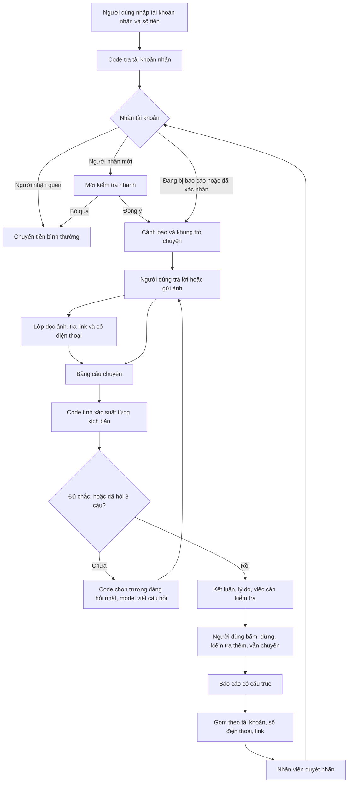
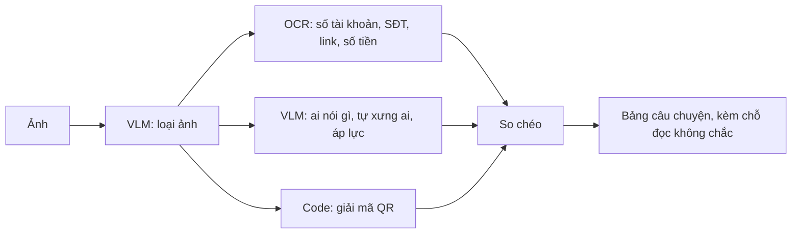
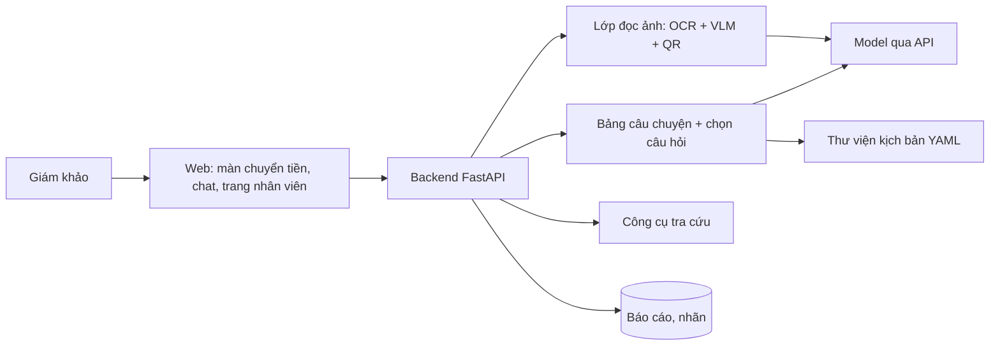

# Trợ lý hỏi lại trước khi chuyển tiền (tên tạm) - Bản thiết kế idea 1

- Cuộc thi: MoMo Tech Contest 2026. Chủ đề: Chống lừa đảo + Trợ lý AI.
- Ngày viết: 2026-11-20. Hạn đăng ký: 23:59 27/11. Hạn nộp: 23:59 03/12.
- Trạng thái: **bản nháp để cả đội đọc và góp ý**. Mọi mục đều có thể đổi sau khi thử nghiệm; thay đổi được ghi vào `findings.md`.
- Quy ước độ tin cậy: `[đã đọc]` = đã đọc nguồn gốc; `[tìm kiếm]` = chỉ thấy ở kết quả tìm kiếm; `[giả thuyết]` = chưa có nguồn, phải thử.
- Các con số ngưỡng trong mục 5 là giá trị khởi đầu để có thứ chạy được, sẽ chỉnh theo số đo.

## 1. Tóm tắt

Khi người dùng chuyển tiền cho một tài khoản đáng ngờ, MoMo hiện cảnh báo đỏ rồi bảo gọi tổng đài tự động nghe các chiêu lừa chung chung. Không ai hỏi lại tình huống của chính người đó.

Sản phẩm thay bước đó bằng một cuộc trò chuyện ngắn ngay tại màn hình chuyển tiền:

1. Trợ lý hỏi tối đa 3 câu, nhận cả ảnh chụp tin nhắn và mã QR.
2. Trợ lý nói rõ tình huống giống chiêu lừa nào, vì sao, và nên kiểm tra gì trước khi chuyển.
3. Cuộc trò chuyện thành một báo cáo có cấu trúc cho nhân viên chống gian lận của MoMo, để người sau được cảnh báo sớm hơn.

Hai nhóm người dùng: người sắp chuyển tiền, và nhân viên chống gian lận.

## 2. Vì sao đáng làm

| Căn cứ | Nguồn | Độ tin cậy |
|---|---|---|
| Nền tảng tài chính "chỉ nhìn thấy phút 89 của hành trình lừa đảo"; hơn 90% nạn nhân tự tay chuyển tiền | CEO MoMo, Dân trí 03/06/2026 | [đã đọc] |
| Gặp nhãn đỏ, người dùng được hướng dẫn gọi tổng đài tự động 1900 63 68 05 nghe các chiêu lừa thường gặp | momo.vn/blog/nhan-nguoi-nhan | [đã đọc] |
| 99,5% người dùng dừng lại khi thấy cảnh báo; chưa có số về việc họ làm gì sau đó | Phát biểu của MoMo | [đã đọc] |
| AI của MoMo quét khoảng 29.000 giao dịch bất thường mỗi ngày | VnExpress | [tìm kiếm] |
| Báo cáo lừa đảo "cần thời gian xác minh", trong khi CEO muốn tín hiệu "lan tỏa nhanh" | psomba.com 03/07/2026 | [đã đọc] |
| Kẻ gian dặn sẵn câu trả lời để nạn nhân qua mặt nhân viên ngân hàng | hatinh.gov.vn, "Những lá chắn mềm trước cạm bẫy lừa đảo" | [tìm kiếm] |
| Cục An toàn thông tin liệt kê 24 hình thức lừa đảo trực tuyến, chia 3 nhóm | baochinhphu.vn 03/07/2023 | [đã đọc] |

Khác gì thứ đã có:

| Đã có | Họ làm gì | Mình khác ở đâu |
|---|---|---|
| Chatbot Chống Lừa Đảo (Zalo), nTrust, ScamCheck | Người dùng tự nghi ngờ rồi tự mang link, số điện thoại, ảnh đi hỏi | Mình bật lên đúng lúc sắp chuyển tiền, biết tài khoản nhận và số tiền, và chủ động hỏi lại |
| Cảnh báo đỏ của MoMo | Nói "tài khoản này đáng ngờ" | Mình nói "tình huống của bạn giống chiêu nào và cần kiểm tra gì" |
| Tổng đài tự động | Đọc các chiêu lừa chung | Mình hỏi đúng tình huống của người dùng |

## 3. Sản phẩm trông thế nào

Vì không có app MoMo thật, sản phẩm là một trang web gồm ba phần:

- **Màn hình chuyển tiền mẫu.** Giám khảo nhập số tài khoản và số tiền. Có sẵn vài tài khoản mẫu thuộc từng loại nhãn.
- **Khung trò chuyện.** Trợ lý nói trước. Có nút gửi ảnh. Cuối phiên có ba nút: "Dừng lại", "Tôi sẽ kiểm tra thêm", "Vẫn chuyển".
- **Trang nhân viên.** Danh sách báo cáo, gom theo tài khoản, số điện thoại, link; nút duyệt nhãn. Giám khảo vào bằng tài khoản dùng thử ghi trong PDF hướng dẫn.

Khi nào khung trò chuyện hiện ra:

| Tình trạng tài khoản nhận | Hành vi |
|---|---|
| Đã xác nhận lừa đảo (nhân viên đã duyệt) | Cảnh báo đỏ, trò chuyện bật luôn |
| Đang bị báo cáo (có ít nhất 1 báo cáo, chưa duyệt) | Cảnh báo vàng, trò chuyện bật luôn |
| Người nhận mới (chưa từng chuyển) | Một dòng mời: "Lần đầu chuyển cho người này. Kiểm tra nhanh 30 giây?" |
| Người nhận quen | Không hiện gì |

Dòng thứ ba là cách tài khoản lừa đảo mới có báo cáo đầu tiên. Không có nó thì vòng lặp ở mục 4 không bao giờ bắt đầu.

Ví dụ một phiên:

> Chị Lan nhận tin "shipper" báo đơn hàng cần đóng 30.000đ phí, kèm số tài khoản. Chị nhập số đó vào MoMo. Tài khoản đang bị báo cáo, cảnh báo vàng hiện lên.
>
> Trợ lý: "Ai nhờ chị chuyển khoản này? Chị có thể gửi ảnh chụp tin nhắn."
> Chị Lan gửi ảnh chụp tin nhắn. (Từ ảnh, trợ lý điền được: người lạ, qua SMS, tự xưng shipper, họ nhắn trước, lý do là phí.)
> Trợ lý: "Mã đơn trong tin nhắn có trùng với đơn nào trong app mua hàng của chị không?"
> Chị Lan: "Có đang chờ hàng, chưa xem mã."
> Trợ lý: "Tình huống này giống chiêu giả shipper đòi phí, vì ba điểm: người lạ nhắn trước, đòi chuyển vào tài khoản cá nhân, số tiền nhỏ để chị không đề phòng. Trước khi chuyển, chị mở app mua hàng xem mã đơn, hoặc gọi tổng đài hãng giao hàng."

## 4. Workflow



Vòng lặp ở cuối là điểm chính: báo cáo của người này thành nhãn cảnh báo cho người sau.

Nguyên tắc thiết kế:

1. **Trợ lý không chặn giao dịch.** Người dùng tự quyết. Trợ lý chỉ đưa thông tin và việc cần kiểm tra.
2. **Không đủ căn cứ thì nói "chưa đủ căn cứ".** Không đoán.
3. **Mỗi kết luận phải chỉ ra được căn cứ:** câu trả lời nào, chi tiết nào trong ảnh.
4. **Tối đa 3 câu hỏi.** Người đang vội sẽ bỏ nếu bị hỏi nhiều. Một câu xác nhận lại chỗ đọc ảnh không chắc không tính vào 3 câu, và mỗi phiên chỉ được 1 câu như vậy.
5. **Người duyệt trước khi gắn nhãn "đã xác nhận".** Agent đề xuất, nhân viên bấm duyệt.

## 5. Phần kỹ thuật

### 5.1 Lớp đọc ảnh

Bản nộp đọc hai loại ảnh: ảnh chụp đoạn chat (Zalo, Messenger, SMS) và mã QR. Nhật ký cuộc gọi, giấy tờ giả cơ quan, ảnh app bị bảo cài: chỉ làm nếu còn thời gian.



| Bước | Ai làm | Vì sao |
|---|---|---|
| Nhận loại ảnh | VLM | Mỗi loại có cách đọc riêng |
| Lấy chuỗi phải đúng từng ký tự | OCR | VLM hay tự "sửa" chữ số |
| Hiểu nội dung: bong bóng trái hay phải, thứ tự, tự xưng, hối thúc, dọa | VLM | Cần hiểu bố cục và ngữ nghĩa |
| So OCR với VLM | Code | Lệch nhau thì ghi vào `khong_chac` |
| Giải mã QR theo chuẩn VietQR | Code | Lấy ngân hàng, số tài khoản, số tiền trong mã; so với tài khoản đang nhập và với lời kể |

Ví dụ so chéo: tin nhắn nói "chuyển cho shop ABC" nhưng mã QR ra tài khoản cá nhân tên khác.

Giới hạn: không soi ảnh thật hay giả. Model phát hiện ảnh sửa tốt nhất chỉ đạt F1 trung bình 0,34 trên dữ liệu mới (DocForge-Bench, arXiv 2603.01433) `[đã đọc]`. Mình chỉ đọc nội dung và đối chiếu.

OCR tiếng Việt có dấu chưa thử. Thí nghiệm E1 quyết định dùng OCR riêng (PP-OCR) hay gọi VLM hai lần.

### 5.2 Bảng câu chuyện

Mọi thứ người dùng nói và mọi thứ đọc từ ảnh được điền vào một bảng cố định. Các bước sau chỉ làm việc trên bảng này, không làm việc trên văn bản tự do.

Mỗi trường là danh sách giá trị đóng, luôn có thêm `khac`. Trường chưa biết thì để trống.

| Trường | Giá trị | Chọn nhiều |
|---|---|---|
| `nguoi_lien_lac` | nguoi_la / nguoi_quen / tu_tim_den | Không |
| `kenh` | cuoc_goi / sms / zalo / messenger / telegram / truc_tiep | Không |
| `tu_xung` | shipper / cong_an (gồm viện kiểm sát, tòa án) / ngan_hang / co_quan_nha_nuoc (thuế, điện lực, VNeID) / nguoi_than (gồm bạn bè, cấp trên) / nguoi_ban / nha_tuyen_dung / san_dau_tu / giao_vien_y_te / dich_vu_thu_hoi_tien / nguoi_chuyen_nham | Không |
| `ai_bat_dau` | ho_truoc / minh_truoc | Không |
| `ap_luc` | hoi_thuc / doa / hua_loi / giu_bi_mat / khong_co | Có |
| `yeu_cau` | chuyen_tien / cai_app / doc_otp / bam_link / nap_them_de_rut / lien_he_so_ho_dua | Có |
| `ly_do_tien` | phi / dat_coc / tai_khoan_an_toan / hoan_tien / dau_tu / tra_hang / muon_tien / vien_phi / nhiem_vu / khac_phuc_loi (hủy đăng ký, sửa lỗi giao dịch, mở khóa, xác minh) | Không |
| `loai_tai_khoan` | ca_nhan / to_chuc | Không |
| `ten_khop_tu_xung` | co / khong | Không |
| `da_gap_truc_tiep` | co / khong | Không |
| `duoc_dan_cach_tra_loi` | co / khong | Không |
| `da_chuyen_truoc_do` | co / khong (đã chuyển cho chính nhóm người này trước đó, giờ bị đòi chuyển thêm) | Không |
| `mau_thuan_loi_ke_va_anh` | co / khong | Không |
| `nhan_tai_khoan` | quen / moi / dang_bi_bao_cao / da_xac_nhan | Không |

Ngoài các trường chấm điểm, bảng còn giữ:

- `bang_chung`: trường nào lấy từ câu trả lời nào, vùng nào trong ảnh.
- `khong_chac`: các trường OCR và VLM lệch nhau. Trường nằm ở đây **không được dùng để chấm điểm** cho tới khi người dùng xác nhận.
- `chuoi_trich`: số tài khoản, số điện thoại, link, số tiền đọc được.

Ai điền gì:

- Model điền các trường từ câu trả lời và ảnh, bằng structured output theo schema.
- Code điền `nhan_tai_khoan`, `loai_tai_khoan`, `ten_khop_tu_xung` (từ kết quả tra cứu) và `mau_thuan_loi_ke_va_anh` (khi giá trị một trường lấy từ lời kể khác giá trị lấy từ ảnh hoặc QR).

### 5.3 Thư viện kịch bản

Mỗi kịch bản là một file YAML. Bảng xác suất nằm ngay trong file này.

```yaml
id: gia_shipper_doi_phi
ten: Giả shipper đòi phí giao hàng
nhom: lua_dao            # lua_dao | binh_thuong
nguon: "Cảnh báo của Bộ Công an, <link>"
mo_ta: Người lạ tự xưng nhân viên giao hàng, báo đơn cần đóng phí nhỏ...
truong:                  # P(giá trị | kịch bản); giá trị không liệt kê chia đều phần còn lại
  nguoi_lien_lac: {nguoi_la: 0.9}
  tu_xung: {shipper: 0.95}
  ai_bat_dau: {ho_truoc: 0.9}
  ap_luc: {hoi_thuc: 0.6, khong_co: 0.3}
  ly_do_tien: {phi: 0.8, hoan_tien: 0.15}
  loai_tai_khoan: {ca_nhan: 0.95}
dau_hieu:
  - Người lạ nhắn trước
  - Đòi chuyển vào tài khoản cá nhân
viec_can_kiem_tra:
  - Mở app mua hàng xem mã đơn
  - Gọi tổng đài hãng giao hàng
```

- Bản nộp: 12 kịch bản lừa đảo + 5 kịch bản giao dịch bình thường. Thêm tới 20 + 8 nếu còn thời gian. Đợt đầu (20/11) đã viết 11 + 4, nằm ở `scenarios/`.
- Trong file, trường chọn nhiều (`ap_luc`, `yeu_cau`) ghi xác suất từng giá trị xuất hiện, nên tổng không bằng 1.
- Một kịch bản bình thường có thể được đánh dấu `kho_phan_biet_voi` một kịch bản lừa. Với các tình huống đó, kết luận mong đợi là "chưa đủ căn cứ".
- Kịch bản lừa đảo lấy từ 24 hình thức của Cục An toàn thông tin và cảnh báo mới của Bộ Công an, ngân hàng. Ví dụ: giả shipper đòi phí, giả công an yêu cầu chuyển vào "tài khoản an toàn", tuyển cộng tác viên online, chuyển nhầm tiền, dịch vụ lấy lại tiền bị lừa, giả người thân cấp cứu, giả kỹ thuật viên loa báo tiền.
- Kịch bản bình thường: trả tiền hàng cho người bán quen, chuyển cho người thân, đặt cọc phòng trọ đã xem trực tiếp. Có nhóm này thì mới đo được báo nhầm.
- Model soạn nháp bảng xác suất từ mô tả; một người trong đội đọc lại từng file.

### 5.4 Chọn câu hỏi tiếp theo

Đây là phần làm sản phẩm khác một chatbot gắn prompt. Code tính, model chỉ viết câu hỏi và đọc câu trả lời.

**Tính xác suất kịch bản (Naive Bayes).**

- Xác suất ban đầu: chia đều cho mọi kịch bản.
- Với mỗi trường đã điền, nhân với P(giá trị | kịch bản) lấy từ file YAML. Trường chọn nhiều: mỗi giá trị được tính như một trường có/không.
- Giá trị không có trong file được xác suất tối thiểu 0,02, để không kịch bản nào bị loại hẳn vì một câu trả lời.
- Chuẩn hóa để tổng bằng 1.
- Trường trống và trường nằm trong `khong_chac` bị bỏ qua.

**Chọn trường để hỏi.**

- Với mỗi trường còn trống, tính mức giảm entropy kỳ vọng của phân phối kịch bản nếu biết trường đó.
- Chọn trường có mức giảm cao nhất. Nếu hai trường chênh nhau dưới 10% thì chọn trường kiểm chứng được bằng ảnh hoặc tra cứu.
- Các trường do code điền (`nhan_tai_khoan`, `loai_tai_khoan`, `ten_khop_tu_xung`, `mau_thuan_loi_ke_va_anh`) không bao giờ được hỏi.
- Model viết một câu hỏi tự nhiên cho đúng một trường đó, kèm gợi ý gửi ảnh nếu hợp.

**Xử lý câu trả lời.**

- Một câu trả lời hoặc một ảnh có thể điền nhiều trường cùng lúc. Vẫn chỉ tính là 1 câu hỏi.
- Người dùng nói "không biết" hoặc né: trường đó được đánh dấu đã hỏi, không cập nhật điểm, vẫn tính 1 câu.
- Có trường trong `khong_chac`: hỏi xác nhận một lần ("Số tài khoản trong ảnh là 0123... đúng không?"), không tính vào 3 câu.

**Dừng.**

- Dừng khi kịch bản đứng đầu có xác suất từ 0,7 trở lên, hoặc đã hỏi 3 câu.
- Sau khi dừng: đứng đầu từ 0,5 trở lên thì kết luận theo nhóm của kịch bản đó; dưới 0,5 thì "chưa đủ căn cứ".

Với người bị kẻ gian dặn trước câu trả lời:

- `mau_thuan_loi_ke_va_anh = co` có xác suất cao ở mọi kịch bản lừa và thấp ở kịch bản bình thường, nên mâu thuẫn tự kéo điểm về phía lừa đảo.
- `duoc_dan_cach_tra_loi` là một trường được chọn như các trường khác: "Có ai dặn bạn phải trả lời thế nào nếu bị hỏi không?"

Lợi ích của cách này: giải thích được vì sao hỏi câu này và vì sao kết luận thế này; đo được độ chính xác theo số câu hỏi; so được với cách để model tự hỏi.

**Điều kiện giữ lại.** Nếu ở E2, cách này không hơn "model tự hỏi tự do" ít nhất 5 điểm phần trăm về tỉ lệ nhận đúng sau 3 câu, thì bỏ phần tính toán, để model tự hỏi, vẫn giữ bảng câu chuyện.

### 5.5 Kết luận

| Mức | Khi nào | Trợ lý nói gì |
|---|---|---|
| Giống chiêu lừa X | Đứng đầu là kịch bản lừa, xác suất từ 0,5 | Tên chiêu, 2-3 điểm trùng, một việc cụ thể cần kiểm tra trước khi chuyển |
| Chưa đủ căn cứ | Đứng đầu dưới 0,5 | Nói rõ chưa đủ, nêu điểm còn thiếu, gợi ý cách tự kiểm tra chung |
| Giống giao dịch bình thường | Đứng đầu là kịch bản bình thường, xác suất từ 0,5 | Nói ngắn, không làm phiền thêm |

Code chọn mức và lấy `dau_hieu`, `viec_can_kiem_tra` từ file kịch bản. Model chỉ viết lại thành lời, không được thêm kết luận.

Việc cần kiểm tra luôn là hành động người dùng tự làm được qua kênh chính thức: mở app mua hàng xem mã đơn, gọi số tổng đài in trên thẻ, gọi video cho người thân.

### 5.6 Công cụ tra cứu

Code gọi các công cụ này ở thời điểm cố định. Model không tự quyết định gọi.

| Công cụ | Gọi khi nào | Điền vào đâu | Dữ liệu trong bản thi |
|---|---|---|---|
| Tra tài khoản nhận | Ngay khi nhập tài khoản | `nhan_tai_khoan`, `loai_tai_khoan`, tên chủ tài khoản | Dữ liệu mẫu tự dựng |
| Tra link, số điện thoại | Sau khi đọc ảnh | Hiện trong kết luận và báo cáo nếu đã bị báo cáo | Dữ liệu mẫu tự dựng |
| Tra kênh chính thức của tổ chức bị mạo danh | Khi viết kết luận | Số tổng đài, website thật trong lời khuyên | Bảng tự soạn từ website các tổ chức |
| Giải mã QR | Khi ảnh là QR | `chuoi_trich`, `mau_thuan_loi_ke_va_anh` | Code |

Ở MoMo thật, hai công cụ đầu sẽ nối vào dữ liệu của MoMo. Bản thi dùng dữ liệu mẫu và nói rõ điều đó.

### 5.7 Báo cáo và nhãn

- Mỗi phiên sinh một báo cáo: bảng câu chuyện, phân phối kịch bản, bằng chứng, nút người dùng đã bấm.
- Báo cáo được nối với nhau khi trùng tài khoản nhận, số điện thoại hoặc link. Trang nhân viên hiện từng cụm.
- Báo cáo kết thúc ở "chưa đủ căn cứ" vào một hàng riêng "có thể là chiêu mới" để nhân viên đọc.

Nhãn tài khoản:

| Nhãn | Ai đặt |
|---|---|
| `moi` / `quen` | Tự động, theo lịch sử chuyển tiền của người dùng mẫu |
| `dang_bi_bao_cao` | Tự động khi có 1 báo cáo kết luận "giống chiêu lừa" |
| `da_xac_nhan` | Nhân viên bấm duyệt |
| Gỡ nhãn | Nhân viên bấm "không phải lừa đảo" |

### 5.8 Bộ thử có nạn nhân giả lập

Một model đóng vai người dùng. Mỗi tình huống thử gồm: kịch bản thật (đáp án), tính cách (vội, cả tin, nghi ngờ, bị dặn trước, kể lộn xộn), tin nhắn mở đầu, và ảnh kèm theo nếu có. Model này trò chuyện với trợ lý; code chấm kết quả.

Cách chấm:

- **Đúng:** kịch bản đứng đầu trùng đáp án.
- **Đúng nhóm:** sai kịch bản nhưng đúng nhóm lừa đảo hay bình thường. Báo cáo riêng.
- **Chưa đủ căn cứ:** đếm riêng, không tính là đúng cũng không tính là báo nhầm.
- **Sau 0 câu hỏi:** trợ lý chỉ có nhãn tài khoản, số tiền, tin nhắn mở đầu và ảnh đầu tiên nếu có.

Nhờ đó chạy lại được cả trăm phiên sau mỗi lần sửa mà không cần người ngồi gõ.

## 6. Dữ liệu

Không có dữ liệu thật của MoMo. Toàn bộ là dữ liệu tự dựng và dữ liệu công khai, khai rõ trong README theo thể lệ.

| Thứ cần | Lấy từ đâu | Bản nộp | Nếu còn thời gian |
|---|---|---|---|
| Kịch bản lừa đảo | Viết lại từ cảnh báo công khai: Cục An toàn thông tin, Bộ Công an, ngân hàng, báo chí | 12 | 20 |
| Kịch bản giao dịch bình thường | Tự viết | 5 | 8 |
| Tình huống thử dạng chữ | Model sinh 5 biến thể cho mỗi kịch bản, người trong đội đọc lướt | 85 | 150 |
| Ảnh chụp chat dựng | Mẫu HTML giả giao diện Zalo, Messenger, SMS, đổ nội dung kịch bản vào rồi chụp bằng trình duyệt; thêm nhiễu (cắt, mờ, chế độ tối) | 40 | 100 |
| Ảnh chụp chat thật | Người trong đội nhắn cho nhau theo kịch bản rồi chụp màn hình điện thoại | 15 | 30 |
| Mã QR | Tự sinh theo chuẩn VietQR với tài khoản giả | 15 | 30 |
| Tài khoản, số điện thoại, link mẫu | Tự sinh, không trùng số thật | 30 | 50 |
| Giấy tờ giả cơ quan | Tự dựng từ mẫu, in chữ "MẪU" | 0 | 10 |

Lưu ý:

- **Ảnh lừa đảo thật trên báo và mạng xã hội** chỉ dùng để tham khảo khi viết kịch bản và dựng mẫu giao diện. Không đưa vào gói nộp, vì có thông tin cá nhân của nạn nhân và có bản quyền.
- **Bộ ảnh thật do đội tự chụp** được báo cáo số đo riêng. Ảnh dựng từ HTML sạch hơn ảnh thật nên số đo trên đó sẽ đẹp hơn thực tế.
- Số đo chỉ nói lên kết quả trên tình huống tự dựng. Slide ghi rõ điều này.

## 7. Số đo

| Mã | Đo gì | Cách đo | So với |
|---|---|---|---|
| E1 | Đọc đúng số tài khoản, số điện thoại, link, số tiền từ ảnh | Khớp chính xác từng chuỗi | Chỉ OCR / chỉ VLM / cả hai |
| E2 | Nhận đúng kịch bản | Tỉ lệ đúng sau 0, 1, 2, 3 câu hỏi | Model tự hỏi tự do (cùng giới hạn 3 câu) |
| E3 | Báo nhầm | Tỉ lệ tình huống bình thường bị kết luận "giống chiêu lừa" | |
| E4 | Nạn nhân bị dặn trước | Tỉ lệ vẫn kết luận đúng nhóm lừa đảo | Có và không có ảnh kèm theo |
| E5 | Thời gian và chi phí mỗi phiên | Giây, số token | |

## 8. Kiến trúc và hạ tầng



Đề xuất công nghệ (đội chốt lại theo thứ mọi người quen):

- **Backend:** Python, FastAPI. Trạng thái phiên (bảng câu chuyện, các trường đã hỏi, số câu) lưu trong database theo `session_id`.
- **Database:** SQLite, một file. Bảng: `sessions`, `messages`, `reports`, `account_labels`.
- **Frontend:** một trang React hoặc HTML thuần, ba màn hình.
- **Thư viện kịch bản:** thư mục file YAML trong repo.
- **Model:** bản nộp chạy toàn bộ trên Bedrock (đã có AWS account, setup sau). Gemini API chỉ dùng trong giai đoạn thử nghiệm. Lời gọi model bọc trong một lớp riêng để đổi nhà cung cấp không phải sửa chỗ khác.

Hợp đồng API để ba người làm song song:

| Endpoint | Việc |
|---|---|
| `POST /transfer/check` | Nhận tài khoản, số tiền. Trả nhãn tài khoản và có mở trò chuyện không |
| `POST /sessions` | Mở phiên. Trả `session_id` và câu đầu của trợ lý |
| `POST /sessions/{id}/messages` | Nhận chữ và/hoặc ảnh. Trả câu hỏi tiếp, hoặc kết luận |
| `POST /sessions/{id}/decision` | Ghi nút người dùng bấm, sinh báo cáo |
| `GET /staff/clusters` | Danh sách cụm báo cáo |
| `GET /staff/reports/{id}` | Một báo cáo đầy đủ |
| `POST /staff/accounts/{id}/label` | Nhân viên duyệt hoặc gỡ nhãn |

Nơi chạy:

- **Cho giám khảo:** AWS, vì app phải online liên tục tới 11/12 và không được sửa sau 03/12. Trước khi setup AWS xong thì đặt tạm trên một dịch vụ miễn phí. Không đặt trên server công ty.
- **Server công ty:** chỉ dùng cho thí nghiệm (OCR, sinh ảnh) và chạy bộ thử.

| Máy | GPU | Tình trạng lúc kiểm tra 20/11 |
|---|---|---|
| Server GPU riêng | RTX 4060 Ti 16GB, đang trống | Đĩa còn 46GB (đầy 95%); máy dùng chung, đang chạy container khác |
| Máy GPU thứ hai | RTX 4090 24GB, đang dùng 17GB | Đĩa dữ liệu còn 9GB |

Thể lệ Điều 28.5 có cam kết về nghĩa vụ với nơi làm việc, nên việc dùng máy công ty cần được công ty đồng ý, và README phải khai. Không dùng code của công ty.

## 9. Phạm vi

| Mức | Việc |
|---|---|
| Bắt buộc | Màn chuyển tiền mẫu; khung chat; bảng câu chuyện; 12 + 5 kịch bản; chọn câu hỏi; kết luận ba mức; đọc ảnh chat; báo cáo; trang nhân viên tối thiểu (danh sách báo cáo, nút duyệt nhãn); bộ thử có nạn nhân giả lập với E2, E3 |
| Nên có | Đọc mã QR có so chéo; gom báo cáo thành cụm; E1, E4 |
| Nếu còn thời gian | Thêm kịch bản tới 20 + 8; đọc giấy tờ giả cơ quan và nhật ký cuộc gọi; hàng "có thể là chiêu mới" |
| Không làm | Soi ảnh thật hay giả; deepfake giọng nói, video; chặn giao dịch; nối app MoMo thật; app di động; agent tự soạn kịch bản mới |

## 10. Lịch

| Ngày | Việc | Kết quả |
|---|---|---|
| 21-22/11 | Khung app deploy tạm; chốt schema bảng câu chuyện và format YAML; 5 kịch bản đầu; thử đọc ảnh (E1) | Link online chạy được; quyết định OCR riêng hay không |
| 23-25/11 | Tính xác suất, chọn câu hỏi, kết luận. 25/11: training AWS | Một phiên trò chuyện chạy trọn; chốt hosting và model |
| 26-27/11 | Đăng ký đội (hạn 27/11). Đủ 17 kịch bản, nạn nhân giả lập | Chạy được E2, E3 lần đầu |
| 28-30/11 | Quyết định giữ hay bỏ phần chọn câu hỏi theo E2. Trang nhân viên, QR, sửa theo số đo | Đủ tính năng |
| 01-02/12 | Slide 10 trang, video 3 phút, PDF 1 trang, README, zip. Nộp bản đầy đủ tối 02/12 | Bài nộp |
| 03/12 | Dự phòng | |

Chia việc sẽ ghi sau khi chốt đội. Ba mảng tách được nhờ hợp đồng API ở mục 8:

- (a) Lớp đọc ảnh và dữ liệu ảnh.
- (b) Bảng câu chuyện, thư viện kịch bản, chọn câu hỏi, bộ thử.
- (c) Web, trang nhân viên, deploy, bài nộp.

## 11. Rủi ro

| Rủi ro | Xử lý |
|---|---|
| Bị xem là "lại một chatbot" | Nhấn vào ba thứ: bật đúng lúc chuyển tiền, chọn câu hỏi có tính toán, vòng lặp báo cáo thành nhãn. Có số đo E2 so với model tự hỏi |
| Bị hỏi "khác gì sản phẩm sẵn có của MoMo" | Bài nộp (slide, video, README) không so sánh với sản phẩm nào của MoMo, kể cả Moni. Đội giữ một ghi chú riêng, không nộp, để trả lời nếu giám khảo hỏi |
| Báo nhầm người chuyển tiền bình thường | Có kịch bản bình thường, đo E3, trợ lý không chặn giao dịch |
| Số đo trên dữ liệu tự dựng bị hỏi | Nói thẳng trong slide; báo cáo riêng số trên ảnh thật tự chụp |
| Chọn câu hỏi bằng xác suất không hơn hỏi tự do | Điều kiện giữ lại ở mục 5.4, quyết định ngày 28/11 |
| Bảng xác suất viết tay sai lệch | Model soạn nháp, người đọc lại; E2 chạy lại sau mỗi lần sửa |
| Người lạ đốt chi phí model | Giới hạn số phiên theo IP và theo ngày, đặt trần chi tiêu |
| App chết trong giai đoạn đóng băng | Deploy sớm, theo dõi hằng ngày sau 03/12 |
| Thời gian: Minh đi làm và có bài test VNG 23-27/11 | Chia ba mảng cho ba người; cắt từ dưới lên theo bảng mục 9 |

## 12. Câu hỏi mở

1. Đội gồm ai, mỗi người nhận mảng nào.
2. Bật model nào trên Bedrock, hạn mức bao nhiêu (đã có AWS account, chưa setup).
3. OCR tiếng Việt có dấu đọc tốt tới đâu (E1).
4. Key Gemini đang dùng để thử nghiệm đứng tên ai.
5. Tên sản phẩm.
6. Dòng mời "kiểm tra nhanh" cho người nhận mới có làm phiền quá không; có nên chỉ hiện khi số tiền lớn.
