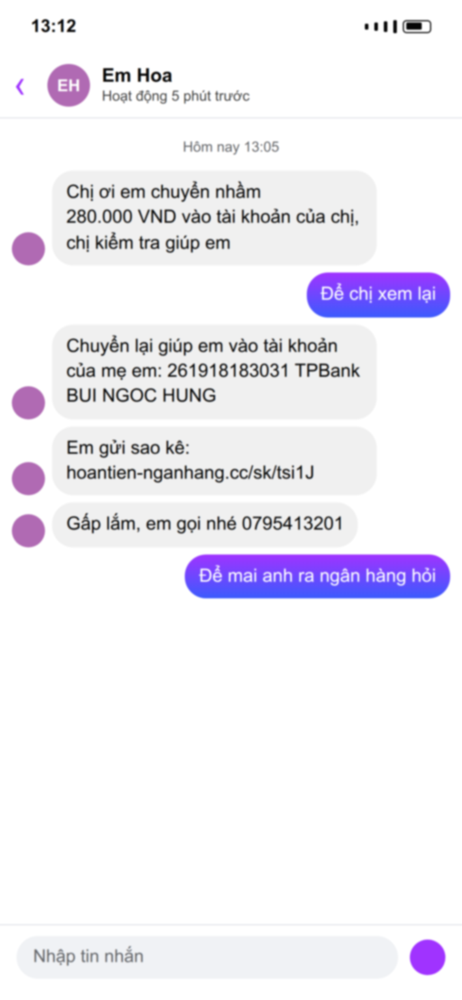
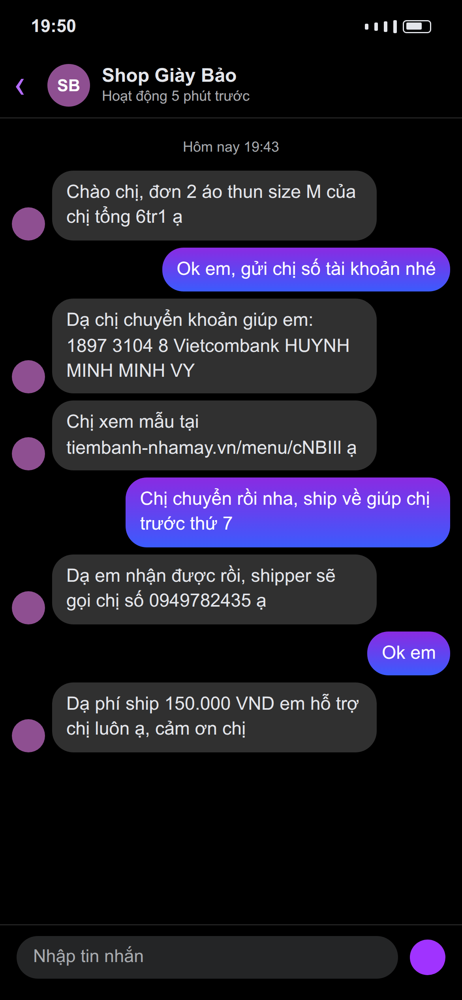

# E1 - Đọc chuỗi chính xác từ ảnh chụp chat

Câu hỏi: có cần OCR riêng bên cạnh VLM để lấy số tài khoản, số điện thoại, link, số tiền từ ảnh chụp chat tiếng Việt không?

Dữ liệu: 180 ảnh tổng hợp (30 ảnh gốc x 6 biến thể), 756 chuỗi cần đọc. 3 kiểu giao diện (giống Zalo / Messenger / SMS) x 5 tình huống. Mọi số, tên, tên miền đều tự sinh ngẫu nhiên.

## Kết luận theo quy tắc đề xuất

- **gemini-3.5-flash-lite**: B thấp nhất 63.3% (Link, JPEG q40); B đạt >=98% ở mọi loại x biến thể: không. C hơn B nhiều nhất +10.0 điểm % (Số TK, mờ nhẹ), so trên cùng tập ảnh; <= 2 điểm: không. => giữ cả hai.
- **gemini-3.8-flash**: B thấp nhất 62.1% (Link, cắt mép trên); B đạt >=98% ở mọi loại x biến thể: không. C hơn B nhiều nhất +3.4 điểm % (Link, cắt mép trên), so trên cùng tập ảnh; <= 2 điểm: không. => giữ cả hai.
- **gemini-4-carbon**: B thấp nhất 86.7% (Link, JPEG q40); B đạt >=98% ở mọi loại x biến thể: không. C hơn B nhiều nhất +3.4 điểm % (Link, cắt mép trên), so trên cùng tập ảnh; <= 2 điểm: không. => giữ cả hai.

**Đề xuất: giữ cả OCR riêng và VLM** (cách B không qua quy tắc với model nào).
- gemini-3.5-flash-lite, Số TK: B sai 8; A (OCR) đúng 8 trong số đó; C sửa được 8, ở biến thể: mờ nhẹ (3), tối (2), thu nhỏ 50% (2), gốc (1); C làm hỏng 0 chuỗi B vốn đúng.
- gemini-3.5-flash-lite, Link: B sai 57; A (OCR) đúng 18 trong số đó; C sửa được 9, ở biến thể: JPEG q40 (2), cắt mép trên (2), gốc (2), thu nhỏ 50% (1), tối (1), mờ nhẹ (1); C làm hỏng 13 chuỗi B vốn đúng.
- gemini-3.8-flash, Link: B sai 55; A (OCR) đúng 15 trong số đó; C sửa được 11, ở biến thể: JPEG q40 (3), mờ nhẹ (2), cắt mép trên (2), tối (2), gốc (2); C làm hỏng 15 chuỗi B vốn đúng.
- gemini-4-carbon, Link: B sai 13; A (OCR) đúng 4 trong số đó; C sửa được 5, ở biến thể: cắt mép trên (2), JPEG q40 (1), gốc (1), mờ nhẹ (1); C làm hỏng 4 chuỗi B vốn đúng.

## 1. Khớp chính xác theo loại chuỗi (gộp 6 biến thể)

Khớp = chuỗi chuẩn hóa của đáp án có trong danh sách model trả về. Chuẩn hóa: số TK bỏ mọi ký tự không phải số; SĐT bỏ dấu cách/chấm và đổi +84 thành 0; link bỏ `https://`, `www.`, dấu cách, hạ chữ thường phần tên miền, giữ nguyên phần đường dẫn; số tiền bỏ dấu cách và dấu phân cách nghìn, giữ đơn vị (`30.000đ` = `30000đ`, `2tr5` khác `2.500.000đ`). Ngoặc là khoảng tin cậy 95% (Wilson).

| Cách | Model | Số TK | SĐT | Link | Số tiền | Tất cả |
|---|---|---|---|---|---|---|
| A | paddleocr | 100.0% (180/180) [98-100] | 100.0% (180/180) [98-100] | 68.7% (123/179) [62-75] | 100.0% (217/217) [98-100] | 92.6% |
| B | gemini-3.5-flash-lite | 95.6% (172/180) [91-98] | 100.0% (180/180) [98-100] | 68.2% (122/179) [61-75] | 100.0% (217/217) [98-100] | 91.4% |
| B | gemini-3.8-flash | 100.0% (180/180) [98-100] | 100.0% (180/180) [98-100] | 69.3% (124/179) [62-76] | 100.0% (217/217) [98-100] | 92.7% |
| B | gemini-4-carbon | 100.0% (180/180) [98-100] | 100.0% (180/180) [98-100] | 92.7% (166/179) [88-96] | 100.0% (217/217) [98-100] | 98.3% |
| C | gemini-3.5-flash-lite | 100.0% (180/180) [98-100] | 100.0% (180/180) [98-100] | 65.9% (118/179) [59-72] | 100.0% (217/217) [98-100] | 91.9% |
| C | gemini-3.8-flash | 100.0% (180/180) [98-100] | 100.0% (180/180) [98-100] | 67.0% (120/179) [60-74] | 100.0% (217/217) [98-100] | 92.2% |
| C | gemini-4-carbon | 100.0% (180/180) [98-100] | 100.0% (180/180) [98-100] | 93.3% (167/179) [89-96] | 100.0% (217/217) [98-100] | 98.4% |

Link tách đôi: **tên miền** = phần trước dấu `/` đầu tiên, hạ chữ thường; **đường dẫn** = phần còn lại, phân biệt hoa thường. Đúng khi model trả về ít nhất một link có phần đó trùng từng ký tự.

| Cách | Model | Link nguyên chuỗi | Tên miền | Đường dẫn |
|---|---|---|---|---|
| A | paddleocr | 68.7% (123/179) | 100.0% (179/179) | 68.7% (123/179) |
| B | gemini-3.5-flash-lite | 68.2% (122/179) | 100.0% (179/179) | 68.2% (122/179) |
| B | gemini-3.8-flash | 69.3% (124/179) | 100.0% (179/179) | 69.3% (124/179) |
| B | gemini-4-carbon | 92.7% (166/179) | 100.0% (179/179) | 92.7% (166/179) |
| C | gemini-3.5-flash-lite | 65.9% (118/179) | 100.0% (179/179) | 65.9% (118/179) |
| C | gemini-3.8-flash | 67.0% (120/179) | 100.0% (179/179) | 67.0% (120/179) |
| C | gemini-4-carbon | 93.3% (167/179) | 100.0% (179/179) | 93.3% (167/179) |

## 2. Khớp chính xác theo biến thể

Mỗi ô: % khớp (số đúng/tổng). Mỗi biến thể có 30 ảnh, khoảng 30 chuỗi mỗi loại: một lỗi = khoảng 3,3 điểm %.

| Cách | Model | Biến thể | Số TK | SĐT | Link | Số tiền |
|---|---|---|---|---|---|---|
| A | paddleocr | gốc | 100.0 (30/30) | 100.0 (30/30) | 73.3 (22/30) | 100.0 (38/38) |
| A | paddleocr | tối | 100.0 (30/30) | 100.0 (30/30) | 66.7 (20/30) | 100.0 (38/38) |
| A | paddleocr | cắt mép trên | 100.0 (30/30) | 100.0 (30/30) | 69.0 (20/29) | 100.0 (27/27) |
| A | paddleocr | JPEG q40 | 100.0 (30/30) | 100.0 (30/30) | 70.0 (21/30) | 100.0 (38/38) |
| A | paddleocr | thu nhỏ 50% | 100.0 (30/30) | 100.0 (30/30) | 63.3 (19/30) | 100.0 (38/38) |
| A | paddleocr | mờ nhẹ | 100.0 (30/30) | 100.0 (30/30) | 70.0 (21/30) | 100.0 (38/38) |
| B | gemini-3.5-flash-lite | gốc | 96.7 (29/30) | 100.0 (30/30) | 73.3 (22/30) | 100.0 (38/38) |
| B | gemini-3.5-flash-lite | tối | 93.3 (28/30) | 100.0 (30/30) | 70.0 (21/30) | 100.0 (38/38) |
| B | gemini-3.5-flash-lite | cắt mép trên | 100.0 (30/30) | 100.0 (30/30) | 72.4 (21/29) | 100.0 (27/27) |
| B | gemini-3.5-flash-lite | JPEG q40 | 100.0 (30/30) | 100.0 (30/30) | 63.3 (19/30) | 100.0 (38/38) |
| B | gemini-3.5-flash-lite | thu nhỏ 50% | 93.3 (28/30) | 100.0 (30/30) | 66.7 (20/30) | 100.0 (38/38) |
| B | gemini-3.5-flash-lite | mờ nhẹ | 90.0 (27/30) | 100.0 (30/30) | 63.3 (19/30) | 100.0 (38/38) |
| B | gemini-3.8-flash | gốc | 100.0 (30/30) | 100.0 (30/30) | 73.3 (22/30) | 100.0 (38/38) |
| B | gemini-3.8-flash | tối | 100.0 (30/30) | 100.0 (30/30) | 63.3 (19/30) | 100.0 (38/38) |
| B | gemini-3.8-flash | cắt mép trên | 100.0 (30/30) | 100.0 (30/30) | 62.1 (18/29) | 100.0 (27/27) |
| B | gemini-3.8-flash | JPEG q40 | 100.0 (30/30) | 100.0 (30/30) | 70.0 (21/30) | 100.0 (38/38) |
| B | gemini-3.8-flash | thu nhỏ 50% | 100.0 (30/30) | 100.0 (30/30) | 73.3 (22/30) | 100.0 (38/38) |
| B | gemini-3.8-flash | mờ nhẹ | 100.0 (30/30) | 100.0 (30/30) | 73.3 (22/30) | 100.0 (38/38) |
| B | gemini-4-carbon | gốc | 100.0 (30/30) | 100.0 (30/30) | 96.7 (29/30) | 100.0 (38/38) |
| B | gemini-4-carbon | tối | 100.0 (30/30) | 100.0 (30/30) | 93.3 (28/30) | 100.0 (38/38) |
| B | gemini-4-carbon | cắt mép trên | 100.0 (30/30) | 100.0 (30/30) | 93.1 (27/29) | 100.0 (27/27) |
| B | gemini-4-carbon | JPEG q40 | 100.0 (30/30) | 100.0 (30/30) | 86.7 (26/30) | 100.0 (38/38) |
| B | gemini-4-carbon | thu nhỏ 50% | 100.0 (30/30) | 100.0 (30/30) | 96.7 (29/30) | 100.0 (38/38) |
| B | gemini-4-carbon | mờ nhẹ | 100.0 (30/30) | 100.0 (30/30) | 90.0 (27/30) | 100.0 (38/38) |
| C | gemini-3.5-flash-lite | gốc | 100.0 (30/30) | 100.0 (30/30) | 63.3 (19/30) | 100.0 (38/38) |
| C | gemini-3.5-flash-lite | tối | 100.0 (30/30) | 100.0 (30/30) | 63.3 (19/30) | 100.0 (38/38) |
| C | gemini-3.5-flash-lite | cắt mép trên | 100.0 (30/30) | 100.0 (30/30) | 69.0 (20/29) | 100.0 (27/27) |
| C | gemini-3.5-flash-lite | JPEG q40 | 100.0 (30/30) | 100.0 (30/30) | 66.7 (20/30) | 100.0 (38/38) |
| C | gemini-3.5-flash-lite | thu nhỏ 50% | 100.0 (30/30) | 100.0 (30/30) | 66.7 (20/30) | 100.0 (38/38) |
| C | gemini-3.5-flash-lite | mờ nhẹ | 100.0 (30/30) | 100.0 (30/30) | 66.7 (20/30) | 100.0 (38/38) |
| C | gemini-3.8-flash | gốc | 100.0 (30/30) | 100.0 (30/30) | 70.0 (21/30) | 100.0 (38/38) |
| C | gemini-3.8-flash | tối | 100.0 (30/30) | 100.0 (30/30) | 63.3 (19/30) | 100.0 (38/38) |
| C | gemini-3.8-flash | cắt mép trên | 100.0 (30/30) | 100.0 (30/30) | 65.5 (19/29) | 100.0 (27/27) |
| C | gemini-3.8-flash | JPEG q40 | 100.0 (30/30) | 100.0 (30/30) | 66.7 (20/30) | 100.0 (38/38) |
| C | gemini-3.8-flash | thu nhỏ 50% | 100.0 (30/30) | 100.0 (30/30) | 66.7 (20/30) | 100.0 (38/38) |
| C | gemini-3.8-flash | mờ nhẹ | 100.0 (30/30) | 100.0 (30/30) | 70.0 (21/30) | 100.0 (38/38) |
| C | gemini-4-carbon | gốc | 100.0 (30/30) | 100.0 (30/30) | 96.7 (29/30) | 100.0 (38/38) |
| C | gemini-4-carbon | tối | 100.0 (30/30) | 100.0 (30/30) | 93.3 (28/30) | 100.0 (38/38) |
| C | gemini-4-carbon | cắt mép trên | 100.0 (30/30) | 100.0 (30/30) | 96.6 (28/29) | 100.0 (27/27) |
| C | gemini-4-carbon | JPEG q40 | 100.0 (30/30) | 100.0 (30/30) | 86.7 (26/30) | 100.0 (38/38) |
| C | gemini-4-carbon | thu nhỏ 50% | 100.0 (30/30) | 100.0 (30/30) | 96.7 (29/30) | 100.0 (38/38) |
| C | gemini-4-carbon | mờ nhẹ | 100.0 (30/30) | 100.0 (30/30) | 90.0 (27/30) | 100.0 (38/38) |

## 3. Chuỗi thừa và số tiền theo giá trị

Chuỗi thừa = model trả về chuỗi không có trong đáp án (đọc sai cũng tính một chuỗi thừa). Số tiền theo giá trị = quy ra số đồng rồi so (`2tr5` = `2.500.000đ`), để thấy lỗi nào chỉ là đổi định dạng. Link khi coi `I` = `l`: hai chữ này gần như trùng nét trong font không chân (Arial, Noto Sans) mà app chat dùng.

| Cách | Model | Thừa Số TK | Thừa SĐT | Thừa Link | Thừa Số tiền | Số tiền khớp giá trị | Link khớp khi coi I = l |
|---|---|---|---|---|---|---|---|
| A | paddleocr | 0 | 0 | 56 | 1 | 100.0% (217/217) | 97.8% (175/179) |
| B | gemini-3.5-flash-lite | 8 | 0 | 57 | 18 | 100.0% (217/217) | 96.1% (172/179) |
| B | gemini-3.8-flash | 0 | 0 | 55 | 2 | 100.0% (217/217) | 97.2% (174/179) |
| B | gemini-4-carbon | 0 | 0 | 13 | 0 | 100.0% (217/217) | 100.0% (179/179) |
| C | gemini-3.5-flash-lite | 0 | 0 | 61 | 17 | 100.0% (217/217) | 97.2% (174/179) |
| C | gemini-3.8-flash | 0 | 0 | 59 | 1 | 100.0% (217/217) | 97.8% (175/179) |
| C | gemini-4-carbon | 0 | 0 | 12 | 0 | 100.0% (217/217) | 100.0% (179/179) |

## 4. Cờ `khong_chac` của cách C

Cờ bật khi chuỗi VLM trả về không trùng (sau chuẩn hóa) với chuỗi nào regex lấy từ OCR. Với chuỗi VLM bỏ sót, tính là có cờ nếu OCR có một chuỗi cùng loại gần giống (tỉ lệ giống >= 0,5).

| Model | Chuỗi đọc sai được gắn cờ | Chuỗi đọc đúng bị gắn cờ nhầm | Theo loại: sai được gắn cờ / đúng bị gắn nhầm |
|---|---|---|---|
| gemini-3.5-flash-lite | 24.6% (15/61) | 0.9% (6/695) | Số TK 0/0, 0/180; SĐT 0/0, 0/180; Link 15/61, 6/118; Số tiền 0/0, 0/217 |
| gemini-3.8-flash | 8.5% (5/59) | 0.1% (1/697) | Số TK 0/0, 0/180; SĐT 0/0, 0/180; Link 5/59, 1/120; Số tiền 0/0, 0/217 |
| gemini-4-carbon | 16.7% (2/12) | 6.0% (45/744) | Số TK 0/0, 0/180; SĐT 0/0, 0/180; Link 2/12, 45/167; Số tiền 0/0, 0/217 |

## 5. OCR cứu được gì

Với mỗi chuỗi B đọc sai: A (OCR + regex) có đọc đúng không, và C có đọc đúng không.

| Model | Loại | B sai | trong đó A đúng | trong đó C đúng | C sai mà B đúng | Biến thể có chuỗi C cứu được |
|---|---|---|---|---|---|---|
| gemini-3.5-flash-lite | Số TK | 8 | 8 | 8 | 0 | mờ nhẹ (3), tối (2), thu nhỏ 50% (2), gốc (1) |
| gemini-3.5-flash-lite | SĐT | 0 | 0 | 0 | 0 | - |
| gemini-3.5-flash-lite | Link | 57 | 18 | 9 | 13 | JPEG q40 (2), cắt mép trên (2), gốc (2), thu nhỏ 50% (1), tối (1), mờ nhẹ (1) |
| gemini-3.5-flash-lite | Số tiền | 0 | 0 | 0 | 0 | - |
| gemini-3.8-flash | Số TK | 0 | 0 | 0 | 0 | - |
| gemini-3.8-flash | SĐT | 0 | 0 | 0 | 0 | - |
| gemini-3.8-flash | Link | 55 | 15 | 11 | 15 | JPEG q40 (3), mờ nhẹ (2), cắt mép trên (2), tối (2), gốc (2) |
| gemini-3.8-flash | Số tiền | 0 | 0 | 0 | 0 | - |
| gemini-4-carbon | Số TK | 0 | 0 | 0 | 0 | - |
| gemini-4-carbon | SĐT | 0 | 0 | 0 | 0 | - |
| gemini-4-carbon | Link | 13 | 4 | 5 | 4 | cắt mép trên (2), JPEG q40 (1), gốc (1), mờ nhẹ (1) |
| gemini-4-carbon | Số tiền | 0 | 0 | 0 | 0 | - |

## 6. Phía gửi (trái/phải)

Ghép tin nhắn đáp án với tin nhắn model trả về theo độ giống chữ (>= 0,5), đúng khi ghép được và cùng phía. Ảnh cắt mép: tin nhắn bị cắt dở không tính.

| Cách | Model | gốc | tối | cắt mép trên | JPEG q40 | thu nhỏ 50% | mờ nhẹ | Tất cả |
|---|---|---|---|---|---|---|---|---|
| B | gemini-3.5-flash-lite | 100.0 | 100.0 | 100.0 | 100.0 | 100.0 | 100.0 | 100.0% (1116/1116) |
| B | gemini-3.8-flash | 100.0 | 100.0 | 100.0 | 100.0 | 100.0 | 100.0 | 100.0% (1116/1116) |
| B | gemini-4-carbon | 100.0 | 100.0 | 100.0 | 100.0 | 100.0 | 100.0 | 100.0% (1116/1116) |
| C | gemini-3.5-flash-lite | 100.0 | 100.0 | 100.0 | 100.0 | 100.0 | 100.0 | 100.0% (1116/1116) |
| C | gemini-3.8-flash | 100.0 | 100.0 | 100.0 | 100.0 | 100.0 | 100.0 | 100.0% (1116/1116) |
| C | gemini-4-carbon | 100.0 | 100.0 | 100.0 | 100.0 | 100.0 | 100.0 | 100.0% (1116/1116) |

## 7. Thời gian và chi phí mỗi ảnh

Giây = thời gian gọi API (gồm mạng) hoặc thời gian OCR một ảnh sau khi nạp model. Token ra gồm token suy nghĩ. Giá USD/1M token (vào/ra) đọc ngày 2026-11-20 tại aistudio.google.com/docs/latest-model và ai.google.dev/gemini-api/docs/pricing: gemini-3.5-flash-lite 0,30/2,50; gemini-3.8-flash 0,75/3,75 (giá giới thiệu tới 31/12/2026, sau đó 1,50/7,50); gemini-4-carbon 2,00/10,00 (giá giới thiệu, **tăng lên 4,00/20,00 từ 01/12/2026**, tức chi phí bảng dưới nhân đôi). Cách C = gọi VLM có kèm chữ OCR; cộng thêm thời gian OCR của A nếu chạy nối tiếp.

| Cách | Model | Giây TB | Giây p50 | Giây p90 | Token vào TB | Token ra TB (trong đó suy nghĩ) | USD/ảnh | USD/1000 ảnh |
|---|---|---|---|---|---|---|---|---|
| A | paddleocr | 20.04 | 22.36 | 23.87 | 0 | 0 (0) | 0.00000 | 0.00 |
| B | gemini-3.5-flash-lite | 5.80 | 3.48 | 10.44 | 1338 | 451 (0) | 0.00153 | 1.53 |
| B | gemini-3.8-flash | 31.16 | 21.20 | 66.61 | 1338 | 3073 (2761) | 0.01253 | 12.53 |
| B | gemini-4-carbon | 18.66 | 12.49 | 22.07 | 1983 | 1296 (1001) | 0.01693 | 16.93 |
| C | gemini-3.5-flash-lite | 5.52 | 3.32 | 9.68 | 1603 | 455 (0) | 0.00162 | 1.62 |
| C | gemini-3.8-flash | 27.70 | 17.21 | 59.89 | 1603 | 2975 (2666) | 0.01236 | 12.36 |
| C | gemini-4-carbon | 21.86 | 12.98 | 26.60 | 2246 | 1501 (1208) | 0.01950 | 19.50 |

## 8. Năm ví dụ đọc sai điển hình

**1. A / paddleocr - Link, ảnh `zalo_02__crop` (cắt mép trên)**


- Đáp án: `congan-xacminh.vip/hs/9lwJ`
- Kết quả: `congan-xacminh.vip/hs/9lwj`; mọi chuỗi Link model trả về: `congan-xacminh.vip/hs/9lwj`
- Dòng OCR liên quan: `11:15` / `Tài khon tm gi: 41258695000` / `11:16` / `congan-xacminh.vip/hs/9lwj trưc` / `17h hôm nay` / `11:17`

**2. B / gemini-3.5-flash-lite - Số TK, ảnh `messenger_06__blur` (mờ nhẹ)**



- Đáp án: `261918183031`
- Kết quả: `26191818301`; mọi chuỗi Số TK model trả về: `26191818301`

**3. B / gemini-3.5-flash-lite - Link, ảnh `messenger_08__blur` (mờ nhẹ)**


- Đáp án: `tiembanh-nhamay.vn/menu/cNBIIl`
- Kết quả: `tiembanh-nhamay.vn/menu/CNBIII`; mọi chuỗi Link model trả về: `tiembanh-nhamay.vn/menu/CNBIII`

**4. B / gemini-3.8-flash - Link, ảnh `messenger_08__blur` (mờ nhẹ)**


- Đáp án: `tiembanh-nhamay.vn/menu/cNBIIl`
- Kết quả: `tiembanh-nhamay.vn/menu/CNBIII`; mọi chuỗi Link model trả về: `tiembanh-nhamay.vn/menu/CNBIII`

**5. C / gemini-3.5-flash-lite - Link, ảnh `messenger_08__dark` (tối)**



- Đáp án: `tiembanh-nhamay.vn/menu/cNBIIl`
- Kết quả: `tiembanh-nhamay.vn/menu/CNBIII`; mọi chuỗi Link model trả về: `tiembanh-nhamay.vn/menu/CNBIII`
- Cờ `khong_chac`: có

## 9. Model và phiên bản

Môi trường chạy (server): python=3.11.18, paddlepaddle=3.3.1, paddleocr=3.7.0, paddlex=3.7.2, google-genai=3.6.1, ocr_device=cpu, cpu=x86_64

- A: PaddleOCR 3.7.0 lang=vi PP-OCRv6 det=PP-OCRv6_medium_det rec=PP-OCRv6_medium_rec device=cpu, enable_mkldnn=False; regex `e1/extract.py`
- B: `gemini-3.5-flash-lite`, model_version trả về: gemini-3.5-flash-lite; structured output (response_json_schema), nhiệt độ và mức suy nghĩ mặc định
- B: `gemini-3.8-flash`, model_version trả về: gemini-3.8-flash; structured output (response_json_schema), nhiệt độ và mức suy nghĩ mặc định
- B: `gemini-4-carbon`, model_version trả về: gemini-4-carbon; structured output (response_json_schema), nhiệt độ và mức suy nghĩ mặc định
- C: `gemini-3.5-flash-lite`, model_version trả về: gemini-3.5-flash-lite; structured output (response_json_schema), nhiệt độ và mức suy nghĩ mặc định
- C: `gemini-3.8-flash`, model_version trả về: gemini-3.8-flash; structured output (response_json_schema), nhiệt độ và mức suy nghĩ mặc định
- C: `gemini-4-carbon`, model_version trả về: gemini-4-carbon; structured output (response_json_schema), nhiệt độ và mức suy nghĩ mặc định

## 10. Nhận xét

- A / paddleocr: số chuỗi đọc sai: Số TK 0, SĐT 0, Link 56, Số tiền 0; 52/56 lỗi link chỉ là nhầm I với l.
- B / gemini-3.5-flash-lite: số chuỗi đọc sai: Số TK 8, SĐT 0, Link 57, Số tiền 0; 50/57 lỗi link chỉ là nhầm I với l.
- B / gemini-3.8-flash: số chuỗi đọc sai: Số TK 0, SĐT 0, Link 55, Số tiền 0; 50/55 lỗi link chỉ là nhầm I với l.
- B / gemini-4-carbon: số chuỗi đọc sai: Số TK 0, SĐT 0, Link 13, Số tiền 0; 13/13 lỗi link chỉ là nhầm I với l.
- C / gemini-3.5-flash-lite: số chuỗi đọc sai: Số TK 0, SĐT 0, Link 61, Số tiền 0; 56/61 lỗi link chỉ là nhầm I với l.
- C / gemini-3.8-flash: số chuỗi đọc sai: Số TK 0, SĐT 0, Link 59, Số tiền 0; 55/59 lỗi link chỉ là nhầm I với l.
- C / gemini-4-carbon: số chuỗi đọc sai: Số TK 0, SĐT 0, Link 12, Số tiền 0; 12/12 lỗi link chỉ là nhầm I với l.

## 11. Cách làm và các điểm lệch so với đề bài

- **Ba cách đọc.** A: PaddleOCR 3.7.0, `lang="vi"`, `ocr_version="PP-OCRv6"` (det `PP-OCRv6_medium_det`, rec `PP-OCRv6_medium_rec`; đây là họ mới nhất trong bản 3.7 có tiếng Việt), rồi regex trong `e1/extract.py`. B: Gemini chỉ nhận ảnh, structured output theo schema trong `e1/vlm.py`. C: cùng lời gọi B, thêm toàn bộ dòng chữ OCR của A vào prompt; code so chuỗi C với chuỗi A sau chuẩn hóa, lệch thì gắn `khong_chac`.
- **Ba model Gemini**, cùng schema, nhiệt độ và mức suy nghĩ mặc định: `gemini-3.5-flash-lite` (flash rẻ nhất), `gemini-3.8-flash` (thêm theo yêu cầu tab kế hoạch), `gemini-4-carbon` (model mạnh nhất key gọi được, theo trang latest-model của Google ngày 2026-11-20). Theo tab kế hoạch, các thí nghiệm sau E1 không dùng dòng gemini-4 nữa.
- **OCR chạy trên CPU, không phải GPU.** Lần cài `paddlepaddle-gpu==3.3.1` từ `paddle-whl.cdn.bcebos.com` (index cu126 chính thức) hết 30 phút mà chưa xong: CDN chỉ trả khoảng 2 MB/s và liên tục `ReadTimeoutError`. Đã dừng đúng hạn và xóa cache. Lần thứ hai cài `paddlepaddle==3.3.1` (CPU) + `paddleocr==3.7.0` từ PyPI, xong trong khoảng 9 phút. Không tìm thấy env nào khác trên server đã có paddle (`~/vidoc-dev` chỉ có rapidocr và mineru), nên không dùng lại env nào.
- **Tắt oneDNN** (`enable_mkldnn=False`): paddle 3.3.1 CPU bật oneDNN thì PP-OCRv6 lỗi `ConvertPirAttribute2RuntimeAttribute not support`. Hệ quả: OCR chậm (xem bảng 7). Thời gian của A trong báo cáo là CPU 12 nhân, đang chạy chung với các lượt gọi API, nên không đại diện cho GPU.
- **paddle ghi vào `~/.cache/paddle` và `~/.paddlex`** bất kể biến `PADDLE_PDX_CACHE_HOME`. Hai thư mục rỗng do lần thử đầu tạo ra đã được xóa. Từ đó mọi tiến trình paddle chạy với `HOME=<dự án>/.cache/home`, nên không ghi gì ra ngoài thư mục dự án.
- **Lỗi dữ liệu đã sửa giữa chừng:** bản sinh đầu để vài link dài tràn ra ngoài mép màn hình, tức đáp án có ký tự không nhìn thấy. Bộ sinh giờ loại mọi chuỗi không nằm gọn trong bong bóng. 13/30 ảnh gốc (78 ảnh) được sinh lại, và kết quả API của các ảnh đó đã được gọi lại.
- **Giới hạn:** ảnh tổng hợp từ HTML, chưa phải ảnh chụp thật. Font là Noto Sans / Arial, nơi `I` và `l` gần như trùng nét. Mỗi ô biến thể × loại chỉ có khoảng 30 chuỗi, nên một lỗi bằng khoảng 3,3 điểm %. Số và tên đều sinh ngẫu nhiên, không đối chiếu với số thật nên không loại trừ tuyệt đối khả năng trùng.

## Chạy lại

Từ thư mục `pretransfer-scam-assistant/` trên máy local:

```bash
./run_e1.sh            # dùng cache: ảnh, OCR, kết quả API đã có thì bỏ qua
FRESH=1 ./run_e1.sh    # xóa data/E1 cả hai phía rồi chạy lại từ đầu
python3 -m e1.score --data data/E1 --out experiments/E1   # chỉ chấm lại
```

Chi tiết từng (ảnh, cách đọc) ở `results.jsonl`: chuỗi trả về, chuỗi đáp án, đúng/sai, cờ, giây, token.
