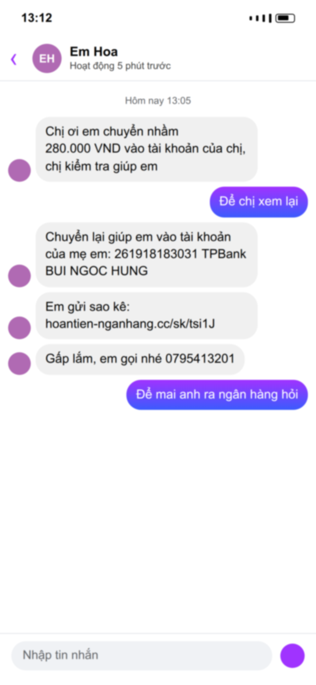
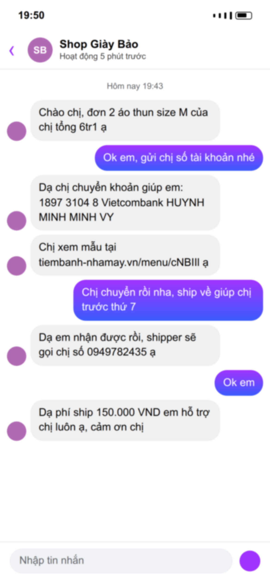
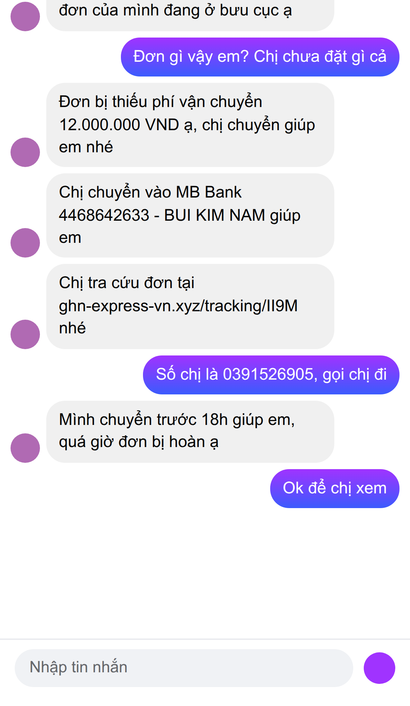
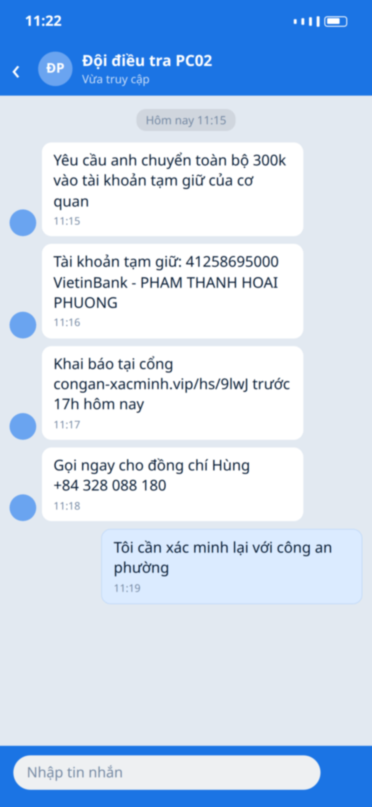
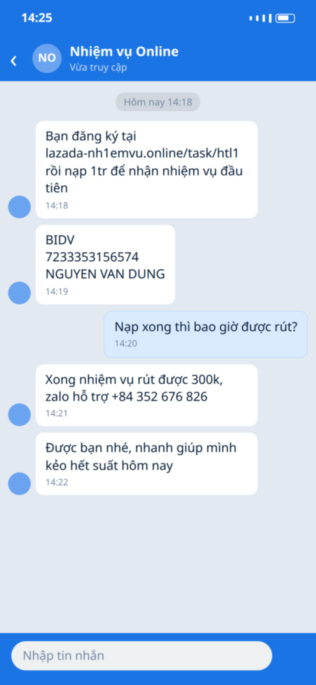

# E1 - Đọc chuỗi chính xác từ ảnh chụp chat

Câu hỏi: có cần OCR riêng bên cạnh VLM để lấy số tài khoản, số điện thoại, link, số tiền từ ảnh chụp chat tiếng Việt không?

Dữ liệu: 180 ảnh tổng hợp (30 ảnh gốc x 6 biến thể), 756 chuỗi cần đọc. 3 kiểu giao diện (giống Zalo / Messenger / SMS) x 5 tình huống. Mọi số, tên, tên miền đều tự sinh ngẫu nhiên.

## Kết luận theo quy tắc đề xuất

- **gemini-3.5-flash-lite**: B thấp nhất 63.3% (Link, JPEG q40); B đạt >=98% ở mọi loại x biến thể: không. C hơn B nhiều nhất +0.0 điểm % (-, -); <= 2 điểm: có. => giữ cả hai.
- **gemini-4-carbon**: B thấp nhất 86.7% (Link, JPEG q40); B đạt >=98% ở mọi loại x biến thể: không. C hơn B nhiều nhất +0.0 điểm % (-, -); <= 2 điểm: có. => giữ cả hai.

**Đề xuất: giữ cả OCR riêng và VLM** (cách B không qua quy tắc với model nào).

## 1. Khớp chính xác theo loại chuỗi (gộp 6 biến thể)

Khớp = chuỗi chuẩn hóa của đáp án có trong danh sách model trả về. Chuẩn hóa: số TK bỏ mọi ký tự không phải số; SĐT bỏ dấu cách/chấm và đổi +84 thành 0; link bỏ `https://`, `www.`, dấu cách, hạ chữ thường phần tên miền, giữ nguyên phần đường dẫn; số tiền bỏ dấu cách và dấu phân cách nghìn, giữ đơn vị (`30.000đ` = `30000đ`, `2tr5` khác `2.500.000đ`). Ngoặc là khoảng tin cậy 95% (Wilson).

| Cách | Model | Số TK | SĐT | Link | Số tiền | Tất cả |
|---|---|---|---|---|---|---|
| B | gemini-3.5-flash-lite | 95.6% (172/180) [91-98] | 100.0% (180/180) [98-100] | 68.2% (122/179) [61-75] | 100.0% (217/217) [98-100] | 91.4% |
| B | gemini-4-carbon | 100.0% (180/180) [98-100] | 100.0% (180/180) [98-100] | 92.7% (166/179) [88-96] | 100.0% (217/217) [98-100] | 98.3% |

## 2. Khớp chính xác theo biến thể

Mỗi ô: % khớp (số đúng/tổng). Mỗi biến thể có 30 ảnh, khoảng 30 chuỗi mỗi loại: một lỗi = khoảng 3,3 điểm %.

| Cách | Model | Biến thể | Số TK | SĐT | Link | Số tiền |
|---|---|---|---|---|---|---|
| B | gemini-3.5-flash-lite | gốc | 96.7 (29/30) | 100.0 (30/30) | 73.3 (22/30) | 100.0 (38/38) |
| B | gemini-3.5-flash-lite | tối | 93.3 (28/30) | 100.0 (30/30) | 70.0 (21/30) | 100.0 (38/38) |
| B | gemini-3.5-flash-lite | cắt mép trên | 100.0 (30/30) | 100.0 (30/30) | 72.4 (21/29) | 100.0 (27/27) |
| B | gemini-3.5-flash-lite | JPEG q40 | 100.0 (30/30) | 100.0 (30/30) | 63.3 (19/30) | 100.0 (38/38) |
| B | gemini-3.5-flash-lite | thu nhỏ 50% | 93.3 (28/30) | 100.0 (30/30) | 66.7 (20/30) | 100.0 (38/38) |
| B | gemini-3.5-flash-lite | mờ nhẹ | 90.0 (27/30) | 100.0 (30/30) | 63.3 (19/30) | 100.0 (38/38) |
| B | gemini-4-carbon | gốc | 100.0 (30/30) | 100.0 (30/30) | 96.7 (29/30) | 100.0 (38/38) |
| B | gemini-4-carbon | tối | 100.0 (30/30) | 100.0 (30/30) | 93.3 (28/30) | 100.0 (38/38) |
| B | gemini-4-carbon | cắt mép trên | 100.0 (30/30) | 100.0 (30/30) | 93.1 (27/29) | 100.0 (27/27) |
| B | gemini-4-carbon | JPEG q40 | 100.0 (30/30) | 100.0 (30/30) | 86.7 (26/30) | 100.0 (38/38) |
| B | gemini-4-carbon | thu nhỏ 50% | 100.0 (30/30) | 100.0 (30/30) | 96.7 (29/30) | 100.0 (38/38) |
| B | gemini-4-carbon | mờ nhẹ | 100.0 (30/30) | 100.0 (30/30) | 90.0 (27/30) | 100.0 (38/38) |

## 3. Chuỗi thừa và số tiền theo giá trị

Chuỗi thừa = model trả về chuỗi không có trong đáp án (đọc sai cũng tính một chuỗi thừa). Số tiền theo giá trị = quy ra số đồng rồi so (`2tr5` = `2.500.000đ`), để thấy lỗi nào chỉ là đổi định dạng. Link khi coi `I` = `l`: hai chữ này gần như trùng nét trong font không chân (Arial, Noto Sans) mà app chat dùng.

| Cách | Model | Thừa Số TK | Thừa SĐT | Thừa Link | Thừa Số tiền | Số tiền khớp giá trị | Link khớp khi coi I = l |
|---|---|---|---|---|---|---|---|
| B | gemini-3.5-flash-lite | 8 | 0 | 57 | 18 | 100.0% (217/217) | 96.1% (172/179) |
| B | gemini-4-carbon | 0 | 0 | 13 | 0 | 100.0% (217/217) | 100.0% (179/179) |

## 4. Cờ `khong_chac` của cách C

Cờ bật khi chuỗi VLM trả về không trùng (sau chuẩn hóa) với chuỗi nào regex lấy từ OCR. Với chuỗi VLM bỏ sót, tính là có cờ nếu OCR có một chuỗi cùng loại gần giống (tỉ lệ giống >= 0,5).

| Model | Chuỗi đọc sai được gắn cờ | Chuỗi đọc đúng bị gắn cờ nhầm | Theo loại: sai được gắn cờ / đúng bị gắn nhầm |
|---|---|---|---|

## 5. OCR cứu được gì

Với mỗi chuỗi B đọc sai: A (OCR + regex) có đọc đúng không, và C có đọc đúng không.

| Model | Loại | B sai | trong đó A đúng | trong đó C đúng | C sai mà B đúng | Biến thể có chuỗi C cứu được |
|---|---|---|---|---|---|---|
| gemini-3.5-flash-lite | Số TK | 8 | 0 | 0 | 0 | - |
| gemini-3.5-flash-lite | SĐT | 0 | 0 | 0 | 0 | - |
| gemini-3.5-flash-lite | Link | 57 | 0 | 0 | 0 | - |
| gemini-3.5-flash-lite | Số tiền | 0 | 0 | 0 | 0 | - |
| gemini-4-carbon | Số TK | 0 | 0 | 0 | 0 | - |
| gemini-4-carbon | SĐT | 0 | 0 | 0 | 0 | - |
| gemini-4-carbon | Link | 13 | 0 | 0 | 0 | - |
| gemini-4-carbon | Số tiền | 0 | 0 | 0 | 0 | - |

## 6. Phía gửi (trái/phải)

Ghép tin nhắn đáp án với tin nhắn model trả về theo độ giống chữ (>= 0,5), đúng khi ghép được và cùng phía. Ảnh cắt mép: tin nhắn bị cắt dở không tính.

| Cách | Model | gốc | tối | cắt mép trên | JPEG q40 | thu nhỏ 50% | mờ nhẹ | Tất cả |
|---|---|---|---|---|---|---|---|---|
| B | gemini-3.5-flash-lite | 100.0 | 100.0 | 100.0 | 100.0 | 100.0 | 100.0 | 100.0% (1116/1116) |
| B | gemini-4-carbon | 100.0 | 100.0 | 100.0 | 100.0 | 100.0 | 100.0 | 100.0% (1116/1116) |

## 7. Thời gian và chi phí mỗi ảnh

Giây = thời gian gọi API (gồm mạng) hoặc thời gian OCR một ảnh sau khi nạp model. Token ra gồm token suy nghĩ. Giá theo bảng giá công khai ngày 2026-11-20 (gemini-4-carbon đang giá giới thiệu đến 30/11). Cách C = gọi VLM có kèm chữ OCR; cộng thêm thời gian OCR của A nếu chạy nối tiếp.

| Cách | Model | Giây TB | Giây p50 | Giây p90 | Token vào TB | Token ra TB (trong đó suy nghĩ) | USD/ảnh | USD/1000 ảnh |
|---|---|---|---|---|---|---|---|---|
| B | gemini-3.5-flash-lite | 5.80 | 3.48 | 10.44 | 1338 | 451 (0) | 0.00153 | 1.53 |
| B | gemini-4-carbon | 18.66 | 12.49 | 22.07 | 1983 | 1296 (1001) | 0.01693 | 16.93 |

## 8. Năm ví dụ đọc sai điển hình

**1. B / gemini-3.5-flash-lite - Số TK, ảnh `messenger_06__blur` (mờ nhẹ)**



- Đáp án: `261918183031`
- Kết quả: `26191818301`; mọi chuỗi Số TK model trả về: `26191818301`

**2. B / gemini-3.5-flash-lite - Link, ảnh `messenger_08__blur` (mờ nhẹ)**



- Đáp án: `tiembanh-nhamay.vn/menu/cNBIIl`
- Kết quả: `tiembanh-nhamay.vn/menu/CNBIII`; mọi chuỗi Link model trả về: `tiembanh-nhamay.vn/menu/CNBIII`

**3. B / gemini-4-carbon - Link, ảnh `messenger_01__crop` (cắt mép trên)**



- Đáp án: `ghn-express-vn.xyz/tracking/II9M`
- Kết quả: `ghn-express-vn.xyz/tracking/lI9M`; mọi chuỗi Link model trả về: `ghn-express-vn.xyz/tracking/lI9M`

**4. B / gemini-3.5-flash-lite - Link, ảnh `zalo_02__blur` (mờ nhẹ)**



- Đáp án: `congan-xacminh.vip/hs/9lwJ`
- Kết quả: `congan-xacminh.vip/hs/9lwj`; mọi chuỗi Link model trả về: `congan-xacminh.vip/hs/9lwj`

**5. B / gemini-3.5-flash-lite - Số TK, ảnh `zalo_05__blur` (mờ nhẹ)**



- Đáp án: `7233353156574`
- Kết quả: `723335315674`; mọi chuỗi Số TK model trả về: `723335315674`

## 9. Model và phiên bản

- B: `gemini-3.5-flash-lite`, model_version trả về: gemini-3.5-flash-lite; structured output (response_json_schema), nhiệt độ và mức suy nghĩ mặc định
- B: `gemini-4-carbon`, model_version trả về: gemini-4-carbon; structured output (response_json_schema), nhiệt độ và mức suy nghĩ mặc định

## 10. Nhận xét và trạng thái (bản tạm: chỉ có cách B)

**Cách A và C chưa chạy.** Lần cài PaddleOCR đầu tiên (`paddlepaddle-gpu==3.3.1` từ index cu126 chính thức `paddle-whl.cdn.bcebos.com`, + `paddleocr==3.7.0`) chạy hết 30 phút mà chưa xong: CDN trả khoảng 2 MB/s và liên tục `ReadTimeoutError (read timeout=15)`. Đã tải xong wheel paddle khoảng 1,9 GB và đang tải các gói `nvidia_*_cu12` (cudnn 545 MB, cublas...) thì đến hạn 30 phút. Đã dừng pip đúng hạn và xóa cache tải về. Bảng 4 và 5 vì vậy trống, và quy tắc đề xuất mới áp dụng được nửa đầu.

Đọc từ số đo của B:

- **Số tiền, SĐT, phía gửi: cả hai model đều 100%** trên mọi biến thể (217 số tiền, 180 SĐT, 1116 tin nhắn).
- **Link là loại chuỗi yếu nhất.** gemini-4-carbon 92,7%; **cả 13 lỗi đều chỉ là nhầm `I` với `l`**. Khi coi `I` = `l` thì carbon đạt 100%. Trong font không chân mà app chat dùng, hai chữ này gần như trùng nét, nên người đọc ảnh cũng không chắc. Một OCR riêng cũng chỉ thấy cùng những điểm ảnh đó, nên khó cứu được loại lỗi này. Cách xử lý hợp lý hơn: code gắn cờ `khong_chac` cho mọi link có `I`/`l`/`1`/`0`/`O` trong phần đường dẫn, rồi hỏi lại người dùng hoặc tra cả hai cách viết. Đây là suy luận, chưa đo; cách A sẽ kiểm chứng.
- **gemini-3.5-flash-lite kém rõ hơn:** link 68,2% (còn 96,1% khi coi I = l, tức vẫn có lỗi khác ngoài I/l: mất ký tự, đổi hoa thường); số TK 95,6%, với lỗi **rơi một chữ số** (`256056962` thành `25605692`, `261918183031` thành `26191818301`). Đây đúng là kiểu lỗi "VLM tự sửa chữ số" mà bản thiết kế lo. Nó còn trả `10-15%` (hoa hồng) như một số tiền ở 18 ảnh.
- Biến thể khó nhất với cả hai model là **JPEG q40 và mờ nhẹ** (link carbon 86,7% và 90%).
- Thời gian: flash-lite trung bình 5,8 giây/ảnh, carbon 18,7 giây/ảnh (p90 22 giây), đều dưới ngưỡng 60 giây mà tab kế hoạch đặt.

Lỗi dữ liệu đã sửa giữa chừng: bản sinh đầu để vài link dài tràn ra ngoài mép màn hình (đáp án có ký tự không nhìn thấy). Bộ sinh giờ loại mọi chuỗi không nằm gọn trong bong bóng. 13/30 ảnh gốc (78 ảnh) được sinh lại, và kết quả API của các ảnh đó đã được gọi lại.

## Chạy lại

Từ thư mục `pretransfer-scam-assistant/` trên máy local:

```bash
./run_e1.sh            # dùng cache: ảnh, OCR, kết quả API đã có thì bỏ qua
FRESH=1 ./run_e1.sh    # xóa data/E1 cả hai phía rồi chạy lại từ đầu
python3 -m e1.score --data data/E1 --out experiments/E1   # chỉ chấm lại
```

Chi tiết từng (ảnh, cách đọc) ở `results.jsonl`: chuỗi trả về, chuỗi đáp án, đúng/sai, cờ, giây, token.
